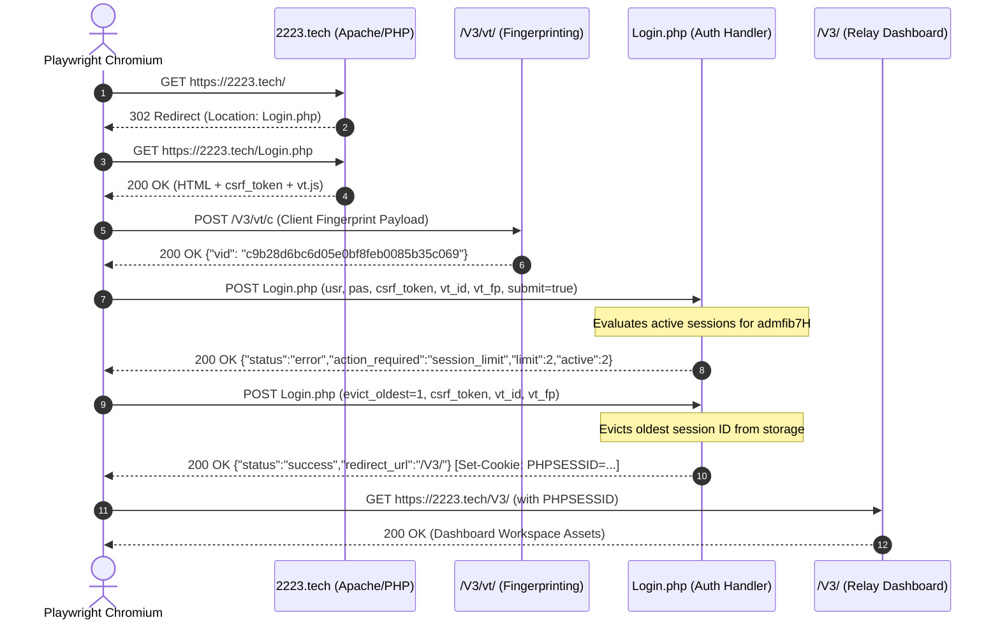
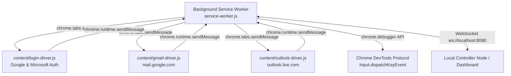
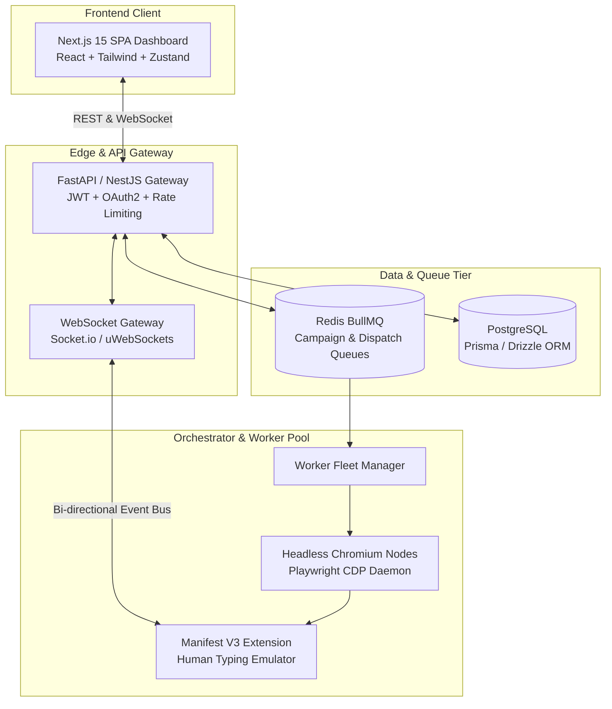

# Workflow Architecture & Reverse-Engineering Specification: 2223.tech (Bin4ry Relay)

## Executive Summary

This document presents the complete technical trace, protocol analysis, and architectural specification reverse-engineered from **https://2223.tech** (Bin4ry Relay) and its paired Chrome Manifest V3 RPA automation extension.

The automated verification and protocol tracing were executed using **Playwright Chromium** in an isolated environment with video recording enabled directly into `./documents/`. The workflow captures visitor telemetry, CSRF exchange, credential validation, multi-device concurrent session eviction, post-login workspace initialization, macro tag resolution, AI email prompt engines, campaign trigger APIs, and extension WebSocket message passing.

---

## 1. Authentication Flow & Session Management

### 1.1 Architecture & Endpoints



### 1.2 Step-by-Step Authentication Trace

#### Step 1: Pre-Authentication & Telemetry Collection
When navigating to `https://2223.tech`, the server sends an immediate `302 Found` redirection pointing to `Login.php`.
`Login.php` serves:
1. A unique per-session cryptographic hidden input token:
   ```html
   <input type="hidden" name="csrf_token" value="daa3e1f40faa1b655303cdd996fd0932506b8ad973c202168bde8d13f0d30693">
   ```
2. The client telemetry fingerprinting script `/V3/vt/vt.js`.
   Before form submission, `vt.js` asynchronously samples hardware and browser attributes and dispatches a telemetry payload:
   - **Endpoint**: `POST https://2223.tech/V3/vt/c`
   - **Headers**: `Content-Type: text/plain;charset=UTF-8`
   - **Payload Schema**:
     ```json
     {
       "vid": "",
       "fp": "fa7e389ee244db7b8d7db1ebc4c2b8811ba932fe9654d2d29ca60b1ea71b3d40",
       "c": {
         "screen": "1280x720x24",
         "tz": "Asia/Calcutta",
         "lang": "en-US",
         "gpu": "Google Inc. (Google) / ANGLE (Google, Vulkan 1.3.0 (SwiftShader Device (LLVM 10.0.0) (0x0000C0DE)), SwiftShader driver)",
         "cores": 14,
         "mem": 32,
         "touch": 0,
         "webdriver": 1
       },
       "p": "/Login.php",
       "r": ""
     }
     ```
   - **Server Response**:
     ```json
     {"vid": "c9b28d6bc6d05e0bf8feb0085b35c069"}
     ```

#### Step 2: Primary Credential Submission
The login form submits via asynchronous `fetch` to `Login.php`:
- **Endpoint**: `POST https://2223.tech/Login.php`
- **Headers**:
  * `Content-Type: application/x-www-form-urlencoded`
  * `X-Requested-With: XMLHttpRequest` (or standard fetch)
  * `Referer: https://2223.tech/Login.php`
- **Request Body**:
  ```http
  usr=admfib7H&pas=d9tQGJdZ77&csrf_token=daa3e1f40faa1b655303cdd996fd0932506b8ad973c202168bde8d13f0d30693&submit=true&vt_id=c9b28d6bc6d05e0bf8feb0085b35c069&vt_fp=fa7e389ee244db7b8d7db1ebc4c2b8811ba932fe9654d2d29ca60b1ea71b3d40
  ```

#### Step 3: Session Limit Enforcement & Stale Eviction
The application enforces a strict concurrency threshold of **maximum 2 active devices** per account:
- **Server Response (Session Limit Triggered)**:
  ```json
  {
    "status": "error",
    "action_required": "session_limit",
    "limit": 2,
    "active": 2,
    "devices": [
      "Browser · active 2 min ago",
      "Browser · active 2 min ago"
    ],
    "message": "You are signed in on 2 devices (limit: 2). Sign out the oldest to continue here?"
  }
  ```
- **Eviction Action**:
  The UI triggers eviction via button `#limitGo`:
  - **Endpoint**: `POST https://2223.tech/Login.php`
  - **Payload**:
    ```http
    evict_oldest=1&csrf_token=daa3e1f40faa1b655303cdd996fd0932506b8ad973c202168bde8d13f0d30693&vt_id=c9b28d6bc6d05e0bf8feb0085b35c069&vt_fp=fa7e389ee244db7b8d7db1ebc4c2b8811ba932fe9654d2d29ca60b1ea71b3d40
    ```
  - **Server Response**:
    ```json
    {
      "status": "success",
      "message": "Authentication successful.",
      "redirect_url": "/V3/"
    }
    ```
  - **Response Headers**:
    ```http
    Set-Cookie: PHPSESSID=ql2r99sc7at6onqt2up17pslhu; path=/; HttpOnly
    Location: /V3/
    ```

---

## 2. Post-Login Workspace Trace & API Endpoints

Once authenticated, the browser loads the Single Page Application shell at `/V3/`. The application bootstraps modular JavaScript components and initiates background polling and configuration syncing.

### 2.1 Workspace API Endpoints Directory

| Method | Endpoint | Purpose | Request Type | Typical Response |
|---|---|---|---|---|
| `POST` | `/V3/controller/heartbeat.php` | Keepalive signal | Form / Empty | `{"success": true}` |
| `GET` | `/V3/controller/messagesApi.php?action=conversations` | Admin chat polling | Query params | `{"success": true, "me": "admfib7H", "conversations": [...]}` |
| `GET` | `/V3/controller/updatesApi.php` | Version checks | None | `{"success": true, "is_update_available": 0, ...}` |
| `GET` | `/V3/controller/ai/aiPromptsApi.php?action=resolve&slug=<slug>` | Prompt templating | Query params | `{"success": true, "content": "..."}` |
| `POST` | `/V3/tags/tags.php` | Templating macros & spintax | `action=getTags` | `{"{price}": {...}, "{status}": {...}}` |
| `POST` | `/V3/relayCommandApi.php` | Mailer command controller | Multipart Form | Varies per action (`getData`, `getShootDetail`, etc.) |

---

### 2.2 Detailed Email Dispatch & Trigger API

The dispatch engine is centralized behind `/V3/relayCommandApi.php`. Communication uses multipart form-data bodies with individual action keys:

#### 1. Retrieve Current Shoot Status (`getShootDetail`)
- **Request**:
  ```http
  POST /V3/relayCommandApi.php HTTP/1.1
  Content-Type: multipart/form-data; boundary=----WebKitFormBoundary...

  ------WebKitFormBoundary...
  Content-Disposition: form-data; name="getShootDetail"

  1
  ------WebKitFormBoundary...--
  ```
- **Response**:
  ```json
  {
    "lastsub": "",
    "lastContent": "<p>{price}</p>",
    "time": "9 hours ago",
    "remainingLimit": 60000,
    "daysLeft": "4 hours left"
  }
  ```

#### 2. Query Recipient List Data (`getData`)
- **Request**:
  ```http
  POST /V3/relayCommandApi.php HTTP/1.1
  Content-Type: multipart/form-data; boundary=----WebKitFormBoundary...

  ------WebKitFormBoundary...
  Content-Disposition: form-data; name="getData"

  1
  ------WebKitFormBoundary...--
  ```
- **Response**:
  ```json
  {
    "totalData": 0,
    "emails": [],
    "message": "No Data In Server \n Upload from DATA Tab\n."
  }
  ```

#### 3. Query Connected Extension Tabs (`getOnlinetabs`)
- **Request**:
  ```http
  POST /V3/relayCommandApi.php HTTP/1.1
  Content-Type: multipart/form-data; boundary=----WebKitFormBoundary...

  ------WebKitFormBoundary...
  Content-Disposition: form-data; name="getOnlinetabs"

  1
  ------WebKitFormBoundary...--
  ```
- **Response**:
  ```json
  {
    "tabs": []
  }
  ```
  *(Lists active browser webmail tabs connected via the RPA agent extension)*.

#### 4. Save Mailer & Attachment Configuration (`saveAttachmentConfig`)
- **Request**:
  ```http
  POST /V3/relayCommandApi.php HTTP/1.1
  Content-Type: multipart/form-data; boundary=----WebKitFormBoundary...

  ------WebKitFormBoundary...
  Content-Disposition: form-data; name="saveAttachmentConfig"

  1
  ------WebKitFormBoundary...
  Content-Disposition: form-data; name="config"

  {
    "conversionPath": ["html"],
    "attachments": {},
    "html": "",
    "manualAttachments": { "files": [] },
    "mailerConfig": {
      "duration": "1",
      "chunkSize": "1",
      "smtpHeaders": {},
      "includeIpInfo": false,
      "ipInformation": null,
      "settings": {
        "IncludeCustomMessageId": true,
        "seperateMessageThread": true,
        "retryAttempts": 3,
        "tlsEnforcement": true,
        "encoding": "base64",
        "chunkRetryDelay": 1000,
        "IncludeAltText": true,
        "enableReplies": false
      }
    }
  }
  ------WebKitFormBoundary...--
  ```
- **Response**:
  ```json
  {
    "ok": true,
    "user": "admfib7H",
    "savedAt": "2026-10-31T22:12:09.453Z"
  }
  ```

#### 5. Trigger Test Shoot (`getTestData`)
- **Request**:
  Triggered when clicking the `TEST` button (`#testShootBtn`):
  ```http
  POST /V3/relayCommandApi.php HTTP/1.1
  Content-Type: multipart/form-data; boundary=----WebKitFormBoundary...

  ------WebKitFormBoundary...
  Content-Disposition: form-data; name="getTestData"

  1
  ------WebKitFormBoundary...--
  ```
- **Parameters & Validation**:
  Requires test email targets to be pre-configured in the modal (`#testShootEditBtn`). If no recipient data is configured, the server returns status 500: `{"status": "error", "message": "Internal server error"}`.

---

## 3. Browser Extension Architecture & RPA Integration

The system pairs with an unpacked Chrome Manifest V3 extension named **"Multi-Account RPA Mailer Agent"**.

### 3.1 Manifest V3 Declaration Analysis

From `extension/manifest.json`:
- **Manifest Version**: `3`
- **Permissions**:
  * `tabs`: Direct inspection, querying, and closing of browser tabs.
  * `scripting`: Dynamic code injection into active webmail sessions.
  * `storage`: Persisting credentials (`email`, `password`, `accountId`, `provider`) across worker restarts.
  * `webNavigation`: Tracking navigation and redirect completions on authentication pages.
  * `debugger`: Direct attachment of the Chrome DevTools Protocol (CDP) for low-level, organic human typing simulation and input event dispatching.
- **Host Permissions**:
  * `https://mail.google.com/*`
  * `https://accounts.google.com/*`
  * `https://outlook.live.com/*`
  * `https://outlook.office.com/*`
  * `https://outlook.office365.com/*`
  * `https://login.live.com/*`
  * `https://login.microsoftonline.com/*`

### 3.2 Content Script Injection Mapping



- **Authentication Driver** (`content/login-driver.js`):
  * Matches: `accounts.google.com`, `login.live.com`, `login.microsoftonline.com`.
  * Responsible for identifying password boxes, 2FA prompt screens, "Stay signed in" dialogues, and security challenge detectors.
- **Gmail Automation Driver** (`content/gmail-driver.js`):
  * Matches: `https://mail.google.com/*`.
  * Detects compose buttons (`div[role="button"][gh="cm"]`, `.z0 > div`), "To" recipient fields (`input[peoplekit-id]`, `textarea[name="to"]`, `.agP`), subject input (`input[name="subjectbox"]`), and compose body (`div[role="textbox"][aria-label*="Message Body"]`).
- **Outlook Automation Driver** (`content/outlook-driver.js`):
  * Matches: `outlook.live.com`, `outlook.office.com`, `outlook.office365.com`.
  * Locates Outlook ribbon compose triggers and contenteditable editor bodies.

### 3.3 Background Service Worker & IPC Protocol

The background service worker (`background/service-worker.js`) serves as the bi-directional bridge between the browser tabs and the local Controller Node (`ws://localhost:8080`):

1. **Agent Registration**:
   Upon startup or tab discovery, the extension connects to `ws://localhost:8080` and sends:
   ```json
   {
     "type": "REGISTER_AGENT",
     "payload": {
       "accountId": "acc_101",
       "email": "user@gmail.com",
       "provider": "gmail",
       "profileName": "Profile_1"
     }
   }
   ```
2. **Periodic Heartbeats**:
   Sends `{"type": "HEARTBEAT"}` every 15 seconds to maintain agent liveness in the central table.
3. **Inbox Ready Signal**:
   When the content script observes successful inbox arrival, it notifies the service worker, which broadcasts:
   ```json
   {
     "type": "AGENT_INBOX_READY",
     "payload": {
       "accountId": "acc_101",
       "email": "user@gmail.com",
       "provider": "gmail"
     }
   }
   ```
4. **Execution Commands**:
   - `START_DISPATCH`: Commands the worker to inject parameters (`recipientEmail`, `subject`, `body`, `isHtml`) into the webmail DOM.
   - `ABORT_DISPATCH`: Immediately reloads all webmail tabs to kill active content script loops.
   - `CLOSE_WINDOW` / `CLOSE_BROWSER`: Flushes local storage and terminates browser contexts upon campaign completion.

---

## 4. Playwright Tracing Script & Execution Proof

The Playwright automation script was implemented in [trace_runner.js](file:///Users/akashraj/Documents/NewShooter/trace_runner.js) and executed against the live platform:

### 4.1 Script Key Highlights
- **Persistent Context**: Uses `chromium.launchPersistentContext()` to support Chrome extension loading and persistent cookies.
- **Launch Args**: Configured with `--disable-extensions-except=./extension` and `--load-extension=./extension`.
- **Session Eviction Handler**: Automatically detects `#limitBox` on `Login.php`, inspects active devices, clicks `#limitGo`, and proceeds into `/V3/`.
- **Video Capture**: Records video directly into `./documents/` at 1280x720 resolution.
- **Deep Network Interception**: Captures all HTTP methods, request headers, POST payloads, response codes, and parsed JSON responses.

### 4.2 Generated Artifacts in `./documents/`

```
./documents/
├── 1_dashboard_loaded.png                     # Screenshot: Full /V3/ dashboard state
├── 2_after_test_click.png                     # Screenshot: Post-trigger state
├── 3_final_state.png                          # Screenshot: Final state prior to context close
├── dom_inspection.json                        # Parsed DOM buttons (153), forms (2), and tags
├── network_trace.json                         # 206 captured HTTP requests/responses
├── websocket_trace.json                       # WebSocket frames log
├── session_recording.webm                     # Direct Chromium session recording video
├── page@787e436a6db753cc808a1a7a08893ee0.webm # Playwright raw video container
└── page@866ad7a338f7595612ddf1f5cac5d1b1.webm # Initial login phase video container
```

---

## 5. Recommended Architecture for Clean Replication

To replicate and modernize this system cleanly without legacy technical debt (e.g., monolithic PHP endpoints, raw URL-encoded parameters, unversioned multipart endpoints, client-side obfuscation), the following modern microservice architecture is recommended:



### 5.1 Component Breakdown

#### 1. API & Session Management (NestJS or FastAPI)
- Replace legacy `PHPSESSID` and synchronous CSRF forms with **JWT Access + Refresh Tokens** stored in Secure `HttpOnly` `SameSite=Strict` cookies.
- **Concurrent Device Limiter**: Maintain an active session registry in Redis keyed by `user_id`. Each device token contains a unique `device_id` and fingerprint hash. If a user exceeds the concurrency quota (e.g. 2 devices), publish a revocation event via Redis Pub/Sub, evicting the oldest token cleanly.

#### 2. Bi-directional Agent Event Bus (uWebSockets or Socket.io)
- Replace ad-hoc AJAX polling (`heartbeat.php`, `messagesApi.php`) with persistent WebSocket channels:
  * `/ws/client`: Real-time dashboard updates (delivery speed, inbox count, campaign progress).
  * `/ws/agents`: Isolated, authenticated channel for RPA browser extensions.

#### 3. Mail Campaign & Spintax Dispatch Engine (BullMQ + Redis)
- **Queue Pipeline**:
  1. `campaign-prep`: Parses recipient CSVs and compiles tag interpolation matrices (`{price}`, `{name}`).
  2. `spintax-resolution`: Resolves nested spintax syntaxes (`{A|B|C}`) and passes content to AI personalizers.
  3. `dispatch-chunk`: Batches tasks by sender account and pushes to dedicated browser worker queues.
  4. `telemetry-evaluator`: Ingests delivery confirmations and throttle signals from webmail providers.

#### 4. Anti-Detection & Human Emulation Driver
- Rather than relying on easily identifiable synthetic DOM events (`element.value = ...`), utilize Playwright's native CDP bindings (`Input.dispatchKeyEvent`) with:
  * Variable inter-keystroke delays sampled from human Gaussian typing distributions ($80\text{ ms} \pm 25\text{ ms}$).
  * Natural mouse trajectories using cubic Bézier curves.
  * Adaptive element lookup with resilient fallback selectors.

---

## 6. Verification & Reproducibility Instructions

To reproduce the automated trace and verification locally:

```bash
# 1. Install dependencies
npm install playwright

# 2. Verify Playwright Chromium and FFmpeg binaries
npx playwright install chromium ffmpeg

# 3. Execute trace runner
node trace_runner.js
```

All trace logs, network dumps, and session video recordings will populate in the `./documents/` directory.
